<a href="https://me.moesegfault.dev">
  <picture>
    <source media="(prefers-color-scheme: dark)" srcset="./assets/profile/banner-dark.svg">
    
  </picture>
</a>

  &nbsp;
  &nbsp;
  

<table>
  <tr>
    <td align="center" width="76"></td>
    <td><b>「代码是我最强的魔法阵，C++是契约时刻显现的银白符文。终身学习？当然是我和宇宙图灵机的共振频率～」</b> CS之海徘徊的咒式构造者 / 超自学主义者 / 有点反复debug的夜行性生物</td>
  </tr>
  <tr>
    <td align="center" width="76"></td>
    <td><b>「数学是通往多重真理之门的贤者石碑，逻辑是我随身携带的四维短剑！」</b> 数学信徒兼吐槽役 / ∑系咒文编织者 / ε-δ的调律师</td>
  </tr>
  <tr>
    <td align="center" width="76"></td>
    <td><b>「语言是异界坐标，书本是心灵跨层传送器，阅读是精神体专属的Warp跳跃指令～」</b> 白天上课偷偷看论文的阅读生命体 / 情报摄取者 / 知识系文具控</td>
  </tr>
  <tr>
    <td align="center" width="76"></td>
    <td><b>「ChatGPT 是我在数据海中的战术参谋，Gemini 是我脑后浮现的同步术式核心，我和它们共同执行深研多线程作战。」</b> 异常熵值制造机 / AI亲合系术师 / Prompt型意识流召唤者（暂无JP语音包适配）</td>
  </tr>
  <tr>
    <td align="center" width="76"></td>
    <td><b>「学校是物理上在场，精神上断线的副本世界……而我，只想自由探索世界主线剧情！」</b> 社会性逃避中 / 学科结构破坏者 / 每日许愿“今天别点名”</td>
  </tr>
  <tr>
    <td align="center" width="76"></td>
    <td><b>「ACGN预警🔔！这里是技术宅萝莉的作战本阵！次元壁？我早就用信仰穿透啦！萌即是观察恒定点，中二就是我的重力中心！」</b> 宇宙萌战前线指挥官 / 多宇宙界面连接器 / Moe系统β版本实验体</td>
  </tr>
</table>

<table>
  <tr>
    <td nowrap><a href="https://same.moesegfault.dev"><b>same</b></a></td>
    <td width="100%">准确找出本地真正相同的文件，整理重复内容。</td>
  </tr>
  <tr>
    <td nowrap><a href="https://scrap.moesegfault.dev"><b>scrap</b></a></td>
    <td width="100%">本地优先的秘密与字段存储，连接桌面应用和命令行。</td>
  </tr>
  <tr>
    <td nowrap><a href="https://xmlsquish.moesegfault.dev"><b>xmlsquish</b></a></td>
    <td width="100%">创建、格式化并构建多文件 XML 提示词项目。</td>
  </tr>
  <tr>
    <td nowrap><a href="https://style.moesegfault.dev"><b>moeSegFault&nbsp;Style</b></a></td>
    <td width="100%">绯红与蜜金的设计系统，面向 React、Astro 与纯 HTML。</td>
  </tr>
</table>
